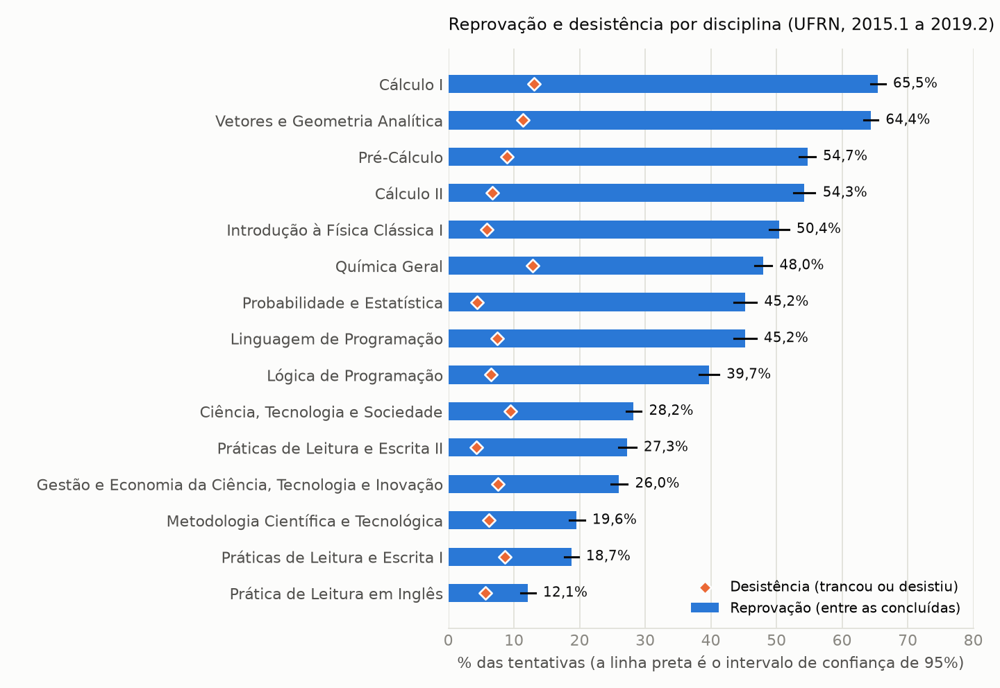
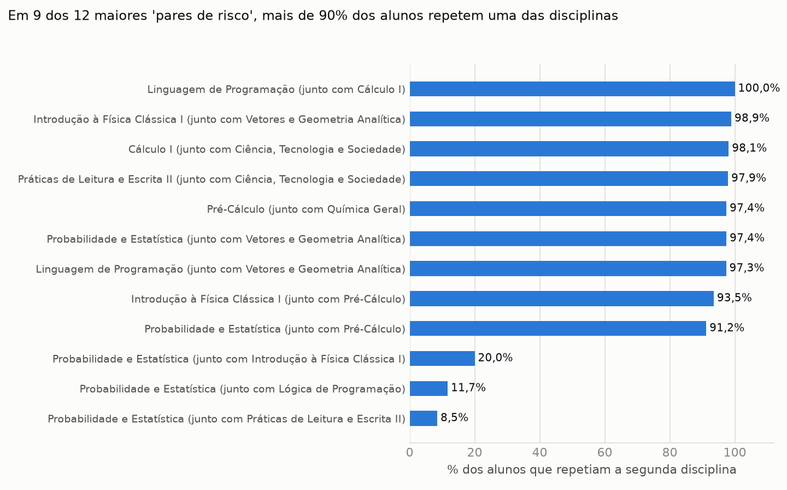
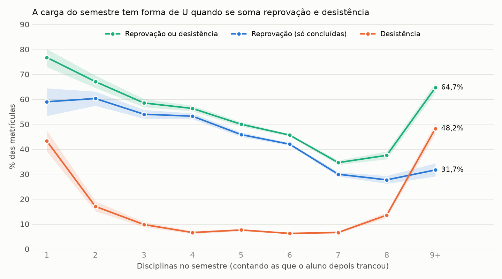

# Termômetro do Semestre

**Resultado em uma linha:** analisei 82.690 matrículas de graduação da UFRN (2015 a 2019) e vi que 9 das 12 combinações de disciplinas que pareciam perigosas eram, na verdade, alunos atrasados repetindo uma delas; o sinal que sobrevive às checagens é pequeno e vem de uma única disciplina, Probabilidade e Estatística.

## O problema

Montar a grade do semestre é decidir no escuro: ninguém mostra ao aluno quais disciplinas do ciclo básico mais reprovam, nem se juntar duas delas muda alguma coisa. Usei os dados abertos da UFRN para olhar isso nas engenharias, na computação e no bacharelado de Ciências e Tecnologia, com as 15 disciplinas mais cursadas.

Uma regra que mantive o tempo todo: o modelo de linguagem só **explica** números já calculados; ele nunca calcula.

## Achados

Todo número abaixo vem de `resultados/*.csv`, gerados pelos scripts da pasta `scripts/`. As taxas são **por tentativa de matrícula**, não por aluno: quem repete uma disciplina conta de novo.

### 1. O ciclo básico concentra a reprovação em três disciplinas de entrada

**Número.** 7.442 tentativas concluídas em Cálculo I: 65,5% terminaram em reprovação (IC 95% 64,4 a 66,6). Vetores e Geometria Analítica: 64,4%. Pré-Cálculo: 54,7%. No extremo oposto, Prática de Leitura em Inglês: 12,1%. A desistência (trancamento ou desistência formal) também é maior nas de entrada: 13,1% em Cálculo I.

**E daí?** Quem planeja o primeiro semestre enfrenta o maior risco em Cálculo I, Vetores e Pré-Cálculo, e não na carga de leitura ou de gestão. Um simulador de grade deveria mostrar essa diferença entre disciplinas antes de qualquer conversa sobre combinações.

**Limitação.** A taxa é por tentativa e inclui repetentes. Não vale ler "65% dos alunos reprovam em Cálculo I". Os dados descrevem a UFRN em 2015 a 2019; o CEFET não está neles, e o mapeamento entre as duas instituições é uma etapa à parte.



### 2. "Cursar duas disciplinas juntas" costuma significar "estar atrasado"

**Número.** Em 9 dos 12 maiores candidatos a "par de risco", entre 91% e 100% dos alunos que cursaram a segunda disciplina junto estavam **repetindo** essa segunda disciplina. Em Práticas de Leitura e Escrita II dado Ciência, Tecnologia e Sociedade, o par com o maior efeito aparente, eram 97,9%. Em Introdução à Física Clássica I dado Vetores e Geometria Analítica, 98,9%. Refazendo as comparações só com alunos na primeira vez, esses 9 pares ficam com no máximo 13 alunos no grupo com o par (em 1 deles, nenhum), longe dos 100 exigidos para concluir.

**E daí?** Um "par perigoso" medido sem separar repetência mostra o perfil do aluno atrasado, não o efeito da combinação. Qualquer ferramenta que oriente a escolha de combinações com esse tipo de número erra o alvo.

**Limitação.** A repetição só é observada a partir de 2015.1, e a "primeira vez" de um aluno que já cursava antes é desconhecida. O vínculo entre matrículas e data de ingresso não existe nos dados abertos.



### 3. Só Probabilidade e Estatística mantém um sinal depois das checagens

**Número.** Entre os 12 candidatos de risco, só ficaram comparações com Probabilidade e Estatística como disciplina de interesse (A e B na primeira vez, pelo menos 100 alunos nos dois grupos, IC por aluno acima de zero). Nelas, alunos que a cursaram no mesmo semestre de outra disciplina (ambas na primeira vez, calouros com histórico) reprovaram mais do que alunos que a cursaram sem ela:

| Cursada junto com | Alunos com / sem a outra | Diferença em pontos percentuais (IC 95%) | OR da regressão sem carga (IC 95%) | Escolhida na descoberta | Confirmada na validação |
| --- | --- | --- | --- | --- | --- |
| Práticas de Leitura e Escrita II | 778 / 768 | +11,1 (6,4 a 15,5) | 1,93 (1,35 a 2,74) | 95 de 100 | 95% |
| Lógica de Programação | 736 / 784 | +8,6 (3,6 a 13,8) | 1,46 (1,05 a 2,04) | 76 de 100 | 63% |
| Introdução à Física Clássica I | 1027 / 432 | +9,2 (3,9 a 14,4) | 1,33 (0,97 a 1,81) | 75 de 100 | 64% |

  Nas 100 divisões aleatórias de alunos, o efeito médio dos finalistas caiu de 10,3 pp na metade de descoberta para 7,6 pp na de validação (inflação média de 2,7 pp, cerca de 26%).

**E daí?** É uma hipótese concreta para investigar (oferta, horários, curso), não uma recomendação de grade.

**Limitação.** É associação, não causa. Introdução à Física Clássica I não se sustenta na regressão (p = 0,075). "Leitura e Escrita II" é uma disciplina de formação geral, improvável como causa direta, o que sugere perfil de curso ou de trajetória ainda não controlado. A validação com divisão de alunos mede a inflação por seleção, **não** elimina confundimento: o procedimento original, sem o filtro de repetência, "confirma" em 90% das validações justamente porque o artefato da repetência se repete em qualquer metade dos alunos.

### 4. A carga do semestre tem forma de U quando se junta reprovação e desistência

**Número.** Considerando reprovação ou desistência sobre todas as matrículas, a taxa é 76,8% com 1 disciplina no semestre, 34,6% com 7 e 64,7% com 9 ou mais. Olhando só a reprovação entre os que concluíram, ela cai de 59,0% (1 disciplina) para 27,7% (8), o que esconde que 48,2% das matrículas com 9 ou mais disciplinas terminam em trancamento ou desistência.

**E daí?** Cargas muito baixas ou muito altas se associam a não concluir, não a aprender mais ou menos. Mostrar só reprovação passaria a mensagem errada de que "mais disciplinas reprova menos".

**Limitação.** A carga é medida no fim do semestre e conta disciplinas depois trancadas; quem cursa uma ou duas disciplinas é, em geral, um aluno irregular. Não dá para dizer que alterar a carga muda o resultado.



## Como conferi o trabalho

- Separei o que **decidi** (população, cursos, disciplinas, método, suporte mínimo, correção para múltiplas comparações, o mapeamento para o CEFET) do que a IA calculou. O registro, com as opções que me foram apresentadas, está no [DIARIO.md](DIARIO.md).
- Pedi a crítica a dois revisores independentes: um modelo da OpenAI e um agente de outro modelo, sem contexto. Eles apontaram erros no trabalho (por exemplo, um indicador de "direção mantida" que na verdade testava significância). O que cada crítica mudou está no diário.
- Validei por divisão de alunos, repetida 100 vezes: escolho os pares numa metade e estimo na outra. O efeito dos finalistas cai de 10,3 para 7,6 pontos percentuais, o que mede quanto a escolha pelo maior efeito infla o resultado.
- Os testes automáticos conferem, entre outras coisas, que o suporte mínimo foi respeitado, que nenhum dado de aluno entra nos resultados e que 10 alunos recalculados por um código independente, direto dos arquivos brutos, batem com a tabela.

## O que eu não afirmo

- Não afirmo que cursar uma disciplina cause reprovação em outra, nem recomendo combinações de matrícula.
- Não afirmo que a taxa vale para outra universidade. O mapeamento para as disciplinas do CEFET-MG, que revisei linha a linha, serve para a próxima etapa, não prova que os resultados se repetem lá.
- A identificação de calouro é aproximada: os dados abertos não ligam a matrícula à data de ingresso.

## Como reproduzir

```bash
python -m venv .venv && .venv/Scripts/pip install -r requirements.txt
python -I scripts/baixar_dados.py          # baixa os dados abertos da UFRN (cerca de 800 MB)
python -I scripts/construir_tentativas.py  # tabela de tentativas em DuckDB
python -I scripts/definir_escopo.py
python -I scripts/analise.py
python -I scripts/checagens_auditoria.py
python -I scripts/validacao.py
python -I scripts/gerar_achados.py
python -I scripts/exportar_json.py
pytest -q tests
```

## Estrutura

- `dados/`: manifesto do download, escopo, mapeamento UFRN → CEFET e o `termometro.json` que alimenta a tela.
- `scripts/`: coleta, pipeline, análise, validação e exportação.
- `resultados/`: tabelas agregadas (sem dados de alunos).
- `achados/`: o texto dos achados, gerado dos resultados.
- `auditoria/`: o prompt enviado ao revisor cético.
- `api-explicar/`: rota que pede ao Gemini uma explicação em linguagem simples e descarta qualquer resposta com número que não estava nos dados.
- `prompts/v0/`: os prompts usados no v0 para a tela.

## Próximo passo

Integrar ao simulador de grade do GradMent, mostrando junto de cada disciplina a taxa de reprovação, a de desistência e o equivalente no CEFET-MG.
